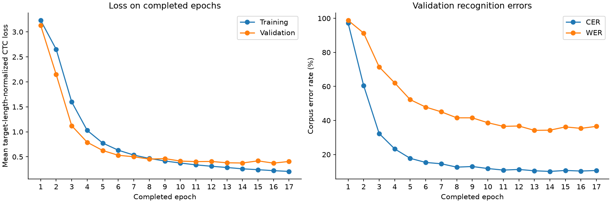

# CNN + LSTM + CTC: implementation and IAM training report

## Final status

The IAM baseline completed **17 epochs**, stopping automatically after epochs
15, 16, and 17 failed to improve the checkpoint-selection score. The requested
maximum was 20; there are no results for epochs 18-20.

**Selected checkpoint: epoch 14, validation CER 10.07%, validation WER 34.29%.**
These are development/validation scores on 100 fixed lines, not final test
results or a claim that preprocessing improved recognition. No optional
preprocessing experiment has been run with this model yet.

| Item | Recorded result |
| --- | --- |
| Dataset | IAM, English handwritten text-line images |
| Training | 6,482 original training lines per epoch |
| Validation | Same fixed 100 lines from the original 976-line validation split |
| Test | 250 saved IAM test indices reserved for later, from the 2,915-line test split |
| Completed epochs | 17 |
| Maximum requested | 20, with early-stopping patience 3 |
| Selected epoch | 14 |
| Selected validation CER | 10.0701516180% |
| Selected validation WER | 34.2948717949% |
| Exact normalized validation lines at selected epoch | 11 / 100 |
| Last epoch | 17; CER 10.61%, WER 36.54% |
| Model parameters | 772,688 |
| Device | CPU, four PyTorch threads |

The most direct evidence is the [epoch report](../results/cnn_lstm_ctc/training/20261114_baseline/iam/EPOCH_RESULTS.md),
[full-precision summary](../results/cnn_lstm_ctc/training/20261114_baseline/iam/epoch_summary.csv),
[original history](../results/cnn_lstm_ctc/training/20261114_baseline/iam/history.csv),
and [final verification record](../results/cnn_lstm_ctc/training/20261114_baseline/iam/FINAL_VERIFICATION.json).

## Purpose and scope

The research asks whether image preprocessing affects different handwriting
recognition architectures differently. The existing pretrained TrOCR code and
results are retained. CNN-LSTM-CTC was built and trained from scratch as the
second architecture.

IAM and Bentham were initially prepared and used in small implementation
checks. Full CNN-LSTM-CTC training was subsequently restricted to **IAM only**.
Bentham preparation and 16-example diagnostic results remain available, but
there is no full Bentham CNN-LSTM-CTC training result. RIMES and HTR-VT are not
implemented in this workflow.

Do not compare this validation score directly with TrOCR's saved test score.
Final architecture comparisons need the same IAM split, sample indices,
normalization, and explicit mandatory input policies. Their training histories
also differ: TrOCR uses existing pretrained weights; this model learns locally
from the IAM training split. Architecture alone cannot explain every difference.

## Data, labels, and reproducibility

- Source: `Teklia/IAM-line`, pinned revision
  `fbdad97500ce54635c0d1ba306bf535cb40656cf`.
- Original train/validation/test partitions are preserved; no new 80/20 split
  was created. Training does not use validation or test images for weight updates.
- The 100 validation indices come from the saved denoising study,
  `results/validation/denoising/20261112T000633091905Z/metadata.json`.
- Preparation settings and training-only vocabularies are recorded in
  `results/cnn_lstm_ctc/data_preparation/20261114T211708884735Z/`.
- IAM's vocabulary contains 79 characters plus CTC blank ID 0: 80 classes.
  IDs are sorted deterministically from training text only. Unknown characters
  cause an error rather than being silently removed or added from held-out text.
- Original transcriptions are retained. Training labels and scoring collapse
  whitespace while preserving case and punctuation. No case folding, punctuation
  removal, language model, or spelling correction is applied.
- Each model receives the same selected validation lines in the same order
  after every epoch. Training is shuffled reproducibly with seed 5112.
- The signed run metadata includes source fingerprints, all source indices,
  model/input settings, training configuration, source-code hashes, and library
  versions. The `test_evaluated` flag is false.

The budget was adjusted during validation development: initially 10 epochs,
then 4, then IAM only up to 20. This was not a preregistered fixed 20-epoch
study. The requests are preserved in the run root's `epoch_limit_request.json`,
`dataset_selection_request.json`, and `training_decisions.jsonl`. The original
signed metadata still describes the initial request; later requests describe
scope/budget changes. Saved checkpoints preserved completed epochs across
those transitions.

## Mandatory image preparation

`src/training/ctc_data.py` implements:

1. Composite transparency onto white and convert to grayscale.
2. Resize to height 64 using LANCZOS, retaining aspect ratio and variable width.
3. Convert pixels to float32 in [0, 1].
4. Pad only the right side of images to the batch's maximum width, using white.
5. Convert normalized target text to character IDs, concatenate targets, and
   record target lengths, original source indices, prepared widths, and the
   minimum CTC alignment length.

Original image files and ground truth are not overwritten. No optional
noise removal, deskewing, CLAHE, intensity normalization, or experimental size
normalization was applied during this baseline training.

Grayscale and height resizing are mandatory for this single-channel model.
An optional grayscale treatment may therefore be redundant. Any experimental
resizing would still be followed by the required height-64 preparation; both
steps must be reported and kept consistent when interpreting later experiments.

## Architecture and CTC

```text
Handwritten line image
  -> mandatory preparation
  -> CNN visual features
  -> bidirectional LSTM sequence context
  -> character classifier and log probabilities
  -> greedy CTC decoding -> predicted text
```

| Part | Implementation |
| --- | --- |
| Input | [batch, 1 channel, 64 pixels high, variable padded width] |
| CNN | Three 3x3 convolutions, channels 32/64/128, ReLU activations |
| Pooling | Two 2x2 pools, then one (2,1) pool |
| Width reduction | floor(prepared width / 4) time positions |
| Height reduction | Mean of remaining CNN height |
| LSTM | Two bidirectional layers, hidden size 128 per direction, dropout 0.1 |
| Classifier | 256 recurrent features to 80 character classes |
| Training objective | CTC loss, blank ID 0, mean target-length-normalized reduction |
| Decoding | Greedy CTC, merge adjacent repeats before removing blanks |

CNN processing first crops each example to its actual prepared width. Packed
LSTM sequences prevent padded positions from affecting either reading
direction. Pixel widths are converted into actual CNN output lengths; they
are not passed directly as CTC sequence lengths.

Each target needs at least its character count plus one extra time position
for each pair of adjacent repeated characters. All training/selected validation
inputs passed the header/label alignment audit. Impossible alignments raise
errors; no samples are silently dropped and infinite CTC losses are not zeroed.
Header auditing does not establish recognition accuracy.

Character IDs are labels, not recognition by themselves. CTC loss compares
model distributions against the correct label sequence without needing letter
boundaries. A synthetic decoder example `h h _ e e _ l l _ l l _ o o` becomes
`hello`; it is explicitly separate from real predictions.

## Training and checkpoint selection

| Setting | Value |
| --- | --- |
| Optimizer | Adam |
| Learning rate | 0.001 |
| Batch size | 4; final partial batch retained |
| Seed | 5112 |
| Gradient clipping norm | 5 |
| CPU threads | 4 |
| Requested maximum | 20 epochs |
| Early-stopping patience | 3 consecutive epochs without an improved score |
| Selection score | Lexicographic: validation corpus CER, then WER, then validation loss |
| Determinism | PyTorch deterministic algorithms enabled; shuffle/RNG states saved |
| Test evaluation | Not performed |

One epoch covers all 6,482 training lines; 1,621 optimizer updates occur per
epoch. Across 17 completed epochs there were 27,557 updates and 110,194 training
image visits. These are repeated visits to 6,482 unique training examples.
The 1,700 validation predictions are repeated assessments of the same 100
validation lines, not 1,700 independent validation examples.

Training loss averages losses observed while weights change throughout the
epoch. Validation loss is measured afterward with fixed weights. Loss is not a
percentage. CER/WER aggregate edit counts over the complete selected validation
corpus rather than averaging each line's error rate.

The summed completed-epoch training durations were **7.87 hours**;
validation took about **86.4 seconds** in total. These logged
training durations include any standby pauses and exclude some setup,
reporting, restart, and unlogged partial-epoch work. They are not an uninterrupted
CPU benchmark or total end-to-end wall time. Windows logs showed standby during
epoch 2, explaining much of that epoch's unusually long elapsed duration.

Recorded core library versions:

| Library | Recorded version |
| --- | --- |
| torch | 2.14.1 |
| numpy | 2.2.6 |
| Pillow | 13.0.0 |
| datasets | 5.1.0 |
| jiwer | 4.0.0 |

## Results for every completed epoch

All scores below are validation results on the same 100 IAM lines.

| Epoch | Training loss | Validation loss | CER (%) | WER (%) | Exact lines / 100 |
| --- | --- | --- | --- | --- | --- |
| 1 | 3.2313 | 3.1311 | 97.28 | 98.82 | 0 |
| 2 | 2.6515 | 2.1477 | 60.53 | 91.35 | 0 |
| 3 | 1.5982 | 1.1219 | 32.34 | 71.47 | 0 |
| 4 | 1.0281 | 0.7907 | 23.31 | 62.07 | 0 |
| 5 | 0.7745 | 0.6258 | 17.76 | 52.24 | 2 |
| 6 | 0.6322 | 0.5305 | 15.34 | 47.86 | 2 |
| 7 | 0.5348 | 0.5007 | 14.57 | 45.09 | 4 |
| 8 | 0.4675 | 0.4544 | 12.58 | 41.56 | 7 |
| 9 | 0.4161 | 0.4639 | 12.97 | 41.56 | 5 |
| 10 | 0.3756 | 0.4146 | 11.77 | 38.68 | 10 |
| 11 | 0.3387 | 0.4036 | 10.86 | 36.54 | 4 |
| 12 | 0.3107 | 0.4067 | 11.22 | 36.75 | 9 |
| 13 | 0.2857 | 0.3802 | 10.45 | 34.19 | 10 |
| 14 | 0.2595 | 0.3757 | 10.07 | 34.29 | 11 |
| 15 | 0.2422 | 0.4187 | 10.64 | 36.22 | 6 |
| 16 | 0.2228 | 0.3733 | 10.30 | 35.36 | 8 |
| 17 | 0.2073 | 0.4068 | 10.61 | 36.54 | 8 |



### What the results support

- Recognition improved substantially from epoch 1 to epoch 14: CER fell from
  97.28% to 10.07%, and WER from 98.82% to 34.29%.
- Epoch 14 had the lowest CER, so it was selected by the stated rule.
- Epoch 13 had the lowest WER (34.19%). Epoch 16 had the lowest validation
  loss (0.3733). The selected checkpoint is not best on every metric.
- Epochs 15-17 did not beat epoch 14's selection score. Training stopped at 17,
  so epochs 18-20 were not run and have no results.
- Training loss continued to decrease after epoch 14, while validation CER/WER
  fluctuated. This suggests a validation plateau and possible overfitting; this
  single run does not establish its cause or prove that no alternative training
  configuration could improve results.
- At the selected checkpoint, 11 of 100 normalized full lines were exact. Partial
  lines may still have many correct words; whole-line exactness, CER, and WER
  describe different aspects of performance.
- Remaining mistakes include spelling, spacing, case, and punctuation. IAM's
  punctuation/word spacing can contribute to measured edits. A CER of 10.07%
  must not be presented as a simple 89.93% accuracy score.

There is one seed, one architecture configuration, and a 100-line development
subset. No confidence intervals, significance tests, robustness claims, unseen
language results, or final-test performance are established here. Repeated
validation inspection and adaptive epoch-budget changes must be disclosed.

## Actual and predicted text

The selected epoch's first saved validation examples are:

| Correct text | Epoch 14 prediction |
| --- | --- |
| wartime naval officer in the B B C's | waitime naval offieer in the BBC's |
| at his most nauseating ) turns the palazzo into a luxury | at his most nanseating ) tums the palazze into a lhxeury |
| Most of those who expound a theory of textual | Mast of those wha expound a thear of tetnal |
| argument against them . | argument against them |

The complete source is [validation_epoch_014.csv](../results/cnn_lstm_ctc/training/20261114_baseline/iam/validation_epoch_014.csv).
The requested random-order export is available as:

- [100-example table](../results/cnn_lstm_ctc/training/20261114_baseline/iam/examples/epoch_014_random_100_seed5112.md)
- [100-example CSV](../results/cnn_lstm_ctc/training/20261114_baseline/iam/examples/epoch_014_random_100_seed5112.csv)
- [Selection manifest](../results/cnn_lstm_ctc/training/20261114_baseline/iam/examples/epoch_014_random_100_seed5112.json)

There were exactly 100 saved validation examples, so random selection without
replacement returns the same complete set in a shuffled order. Python's
`random.Random(5112).sample` determines the order. Original text and predictions
are unchanged. This is not a new random dataset, additional inference, or test
evaluation. Prediction CSVs for all epochs are linked in the epoch report.

## Checkpoints and continuation

| Artifact | Meaning |
| --- | --- |
| `iam/best.pt` | Selected epoch 14; 22,694 updates; inference/preprocessing comparison checkpoint |
| `iam/last.pt` | Completed epoch 17; 27,557 updates; optimizer, history, and RNG/shuffle states for resume |
| `iam/epoch_checkpoints/epoch_002.pt` through `epoch_017.pt` | Available per-epoch snapshots |
| Epoch 1 weights | Unavailable: overwritten before archiving began; metrics and predictions remain |

`.pt` files are binary PyTorch data, not text documents. They contain model
weights, configuration, vocabulary, input settings, and training state. The
selected `results/cnn_lstm_ctc/training/20261114_baseline/iam/best.pt` is included
in Git for inference. Other checkpoints remain ignored by Git;
preserve/transfer those separately with their SHA-256 hashes.
Checkpoint/archive hashes are recorded in `FINAL_VERIFICATION.json` and
`epoch_summary.csv`. No missing checkpoint was fabricated or reconstructed.

Load the selected model from the project root:

```python
from src.models import CNNLSTMCTCRecognizer

recognizer = CNNLSTMCTCRecognizer.from_checkpoint(
    "results/cnn_lstm_ctc/training/20261114_baseline/iam/best.pt",
    device="cpu",
)
# prediction = recognizer.predict(a_pillow_line_image)
# recorded_config = recognizer.to_config()
```

Loading restores the matching character vocabulary and mandatory image
preparation. Configuration includes checkpoint path, SHA-256, and epoch.
The untrained adapter rejects recognition reports without trained weights.

Epoch-boundary resume is implemented and tested: completed work need not restart
at epoch 1. Identity checks require the same data, model, software, preparation,
and training settings; only the maximum epoch limit can change in place.
Interrupted partial epochs are repeated from the last completed checkpoint.

**Current early-stopped run:** `last.pt` has patience counter 3. Raising only
`--epochs` does not reset that counter, so it will not automatically train epoch
18. Changing patience also changes the protected run identity. Any deliberate
continuation needs a separately documented continuation policy/run that retains
its parent checkpoint; no continuation was started in this documentation task.
Use `best.pt`, not `last.pt`, for the planned frozen-model comparison.

For an independent rerun from scratch, use a new output folder; the following
command is a reproducibility example and was not run as part of documentation:

```powershell
.\.venv\Scripts\python.exe -m src.training.ctc_training --datasets iam --output results/cnn_lstm_ctc/training/iam_new_run --epochs 20 --patience 3 --threads 4
```

## Files and notebooks

| Path | Purpose |
| --- | --- |
| `src/training/ctc_data.py` | Training-only vocabulary, mandatory image preparation, split wrapper, batching |
| `src/models/cnn_lstm_ctc.py` | CNN, bidirectional LSTM, classifier, CTC loss, decoder, recognizer adapter |
| `src/models/__init__.py` | Exposes the new model/configuration/adapter alongside TrOCR |
| `src/training/ctc_training.py` | Alignment audit, train/validation loop, selection, checkpoints/resume, plots, CLI |
| `src/training/epoch_reporting.py` | Checks saved metrics/cohorts, documents epochs, archives available checkpoints |
| `notebooks/cnn_lstm_ctc/01_data_preparation.ipynb` | Real image comparisons, label-ID tables, split charts, text-length histograms |
| `notebooks/cnn_lstm_ctc/02_model_check.ipynb` | Untrained forward/loss/backward checks and synthetic decoder example |
| `notebooks/cnn_lstm_ctc/03_training.ipynb` | Final status, history, graphs, epoch table, checkpoint usage |
| `notebooks/cnn_lstm_ctc/04_local_images_recognition.ipynb` | Local handwriting read using the selected checkpoint; previews, predictions and scores |
| `tests/test_ctc_data.py` | Image/label preservation, encoding, batching and CTC target checks |
| `tests/test_cnn_lstm_ctc.py` | Architecture, padding consistency, gradients, decoding and adapter checks |
| `tests/test_ctc_training.py` | Real updates, reload, exact resume, early stopping, alignment/split protection |
| `tests/test_epoch_reporting.py` | Reports must match predictions/cohorts and never invent results or weights |
| `results/cnn_lstm_ctc/data_preparation/` | Vocabulary/settings and exported preparation images/graphs |
| `results/cnn_lstm_ctc/model_check/` | Random-initialization implementation checks |
| `results/cnn_lstm_ctc/training_smoke/` | Separate 16-example training diagnostics for IAM/Bentham |
| `results/cnn_lstm_ctc/input_audit/` | Additional Bentham alignment preflight |
| `results/cnn_lstm_ctc/training/20261114_baseline/iam/` | Completed full IAM baseline and final artifacts |

Do not use `training_smoke` CSVs as the final model's predictions. The saved
preparation/model-check notebooks also include Bentham because that was the
initial implementation scope; full IAM training is the completed research run.

The run-specific `apply_epoch_limit.py` and `apply_iam_only.py` supervisors in
the run root were used to preserve epoch checkpoints during scope/budget
changes. Their request states now record completion/supersession; they are
historical control artifacts, not services that must keep running.

## Verification and remaining work

The existing implementation test suite passed **59 tests** after epoch
reporting was added. This documentation update independently checked all
17 epoch metrics against 1,700 saved predictions, unchanged source indices and
original text across epochs, all 16 archived checkpoint SHA-256 hashes, best/
last checkpoint epochs and signatures, and the 100-example export. See the
machine-readable final verification record. No training or new dataset inference
was performed during this documentation update. CPU behavior was checked;
GPU execution and final test/preprocessing performance remain untested.

Next research steps:

1. Freeze epoch 14 as the current baseline checkpoint.
2. On validation, compare optional preprocessing individually, select settings,
   and then define combined/order treatments without looking at test results.
3. Keep required grayscale/resize preparation consistent; document redundant
   treatments and the interaction of experimental resizing with mandatory resize.
4. Evaluate the frozen choices on the same 250 IAM test lines as TrOCR once the
   protocol is fixed. Record corpus CER/WER, timings, configs, and predictions.
5. Discuss relative changes within each model's own baseline and disclose
   differences in training provenance. Do not infer architecture or language
   effects from incomparable splits or from this single validation run alone.

## Subsequent local-image diagnostic

After IAM training completed, the selected epoch 14 checkpoint was run on all
10 images under `data/local/`, using existing manifest validation labels
unchanged. This was inference only: no retraining, checkpoint selection,
optional preprocessing, spelling correction, or IAM test evaluation occurred.
The existing local loader handles EXIF orientation and white transparency
compositing before mandatory model preparation.

The local corpus scored **28.10% CER and 78.67% WER**. These different images
must be reported separately from IAM validation scores. Labels are as supplied
and model outputs are preserved exactly. This small check does not establish
robustness or generalization.

- [Executed notebook](../notebooks/cnn_lstm_ctc/04_local_images_recognition.ipynb)
- [Images, actual text and predictions](../results/cnn_lstm_ctc/local_predictions/20261115T054718447180Z/PREDICTIONS.md)
- [Predictions CSV](../results/cnn_lstm_ctc/local_predictions/20261115T054718447180Z/predictions.csv)
- [Corpus summary](../results/cnn_lstm_ctc/local_predictions/20261115T054718447180Z/summary.csv)
- [Configuration and hashes](../results/cnn_lstm_ctc/local_predictions/20261115T054718447180Z/metadata.json)

All 10 manifest-listed images were covered. Original image files, manifest and
checkpoint bytes were checked unchanged. Results are in a fresh local folder;
original IAM training records remain unchanged.
