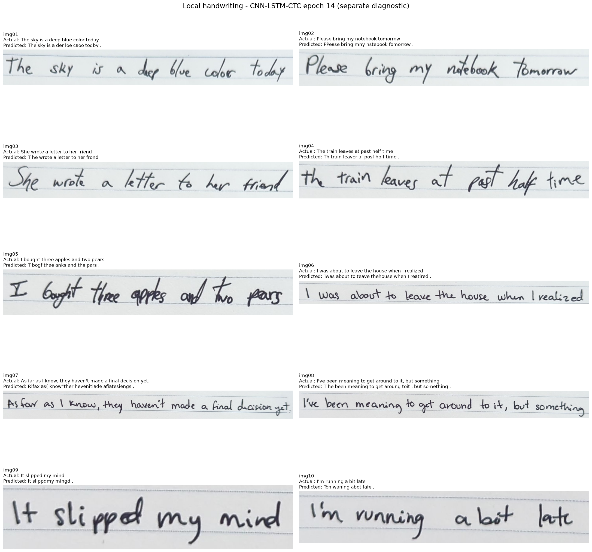

# Local handwriting: CNN-LSTM-CTC epoch 14

Read 10 local images with the selected IAM checkpoint. No training or optional preprocessing ran.
Correct text is copied from the local manifest unchanged. This is a local diagnostic, not final IAM test performance.

Corpus CER: **28.10%**; WER: **78.67%** on 10 labeled local images.

| Image | Correct text | Model prediction |
| --- | --- | --- |
| img01 | The sky is a deep blue color today | The sky is a der loe caoo todby . |
| img02 | Please bring my notebook tomorrow | PPease bring mny nstebook fomorrow . |
| img03 | She wrote a letter to her friend | T he wrote a letter to her frond |
| img04 | The train leaves at past helf time | Th train leaver af posf hoff time . |
| img05 | I bought three apples and two pears | T bogf thae anks and the pars . |
| img06 | I was about to leave the house when I realized | Twas about to teave thehouse when I reatired . |
| img07 | As far as I know, they haven't made a final decision yet. | Rifax as( know"ther hevenitiade afiatesiengs . |
| img08 | I've been meaning to get around to it, but something | T he been meaning to get aroung toit , but something . |
| img09 | It slipped my mind | It slippdmy mingd . |
| img10 | I'm running a bit late | Ton waning abot fafe . |

[Full predictions CSV](predictions.csv) | [Corpus summary](summary.csv) | [Run metadata](metadata.json)

